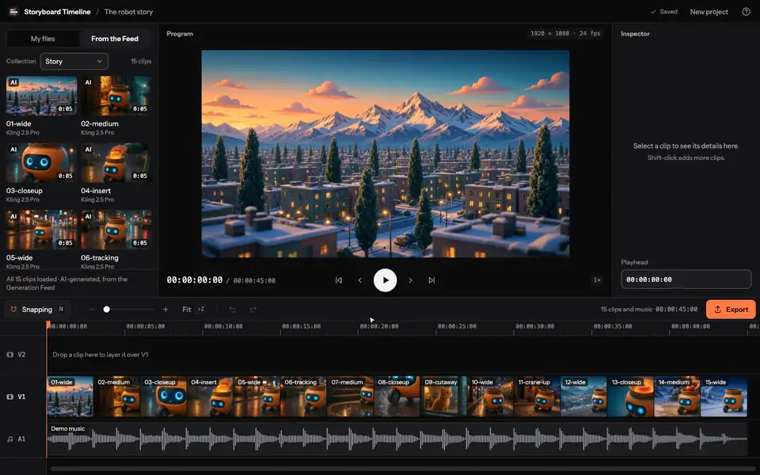
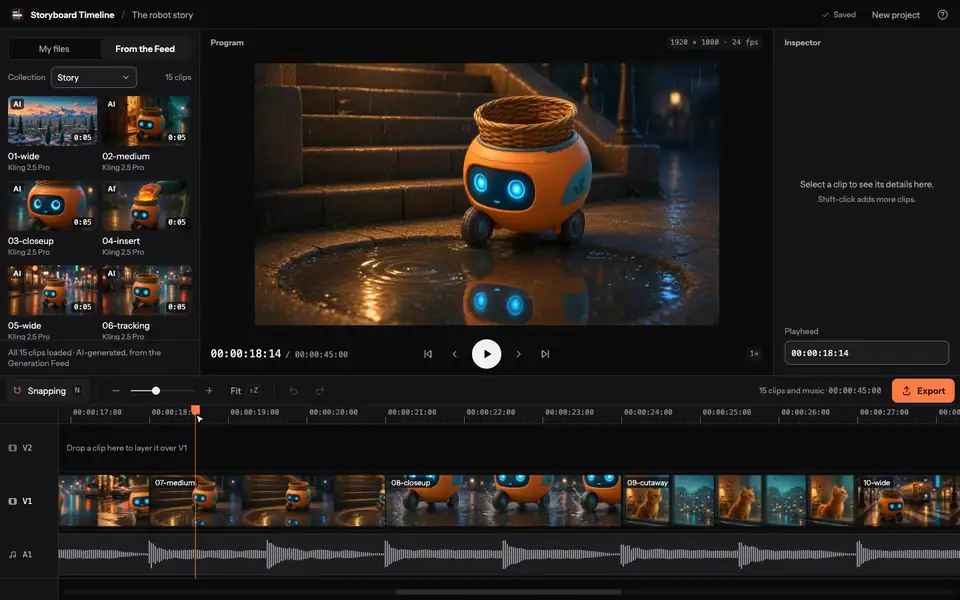
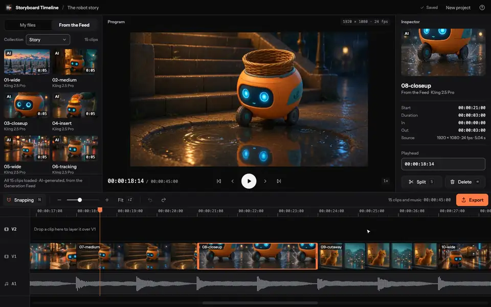
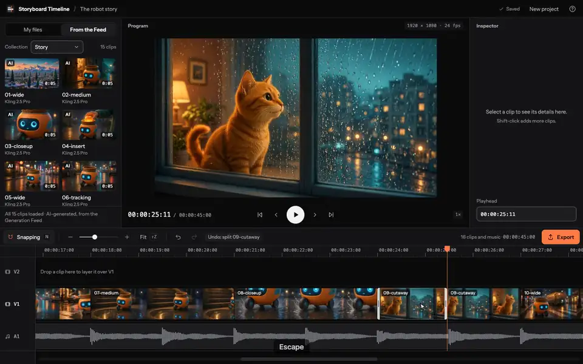
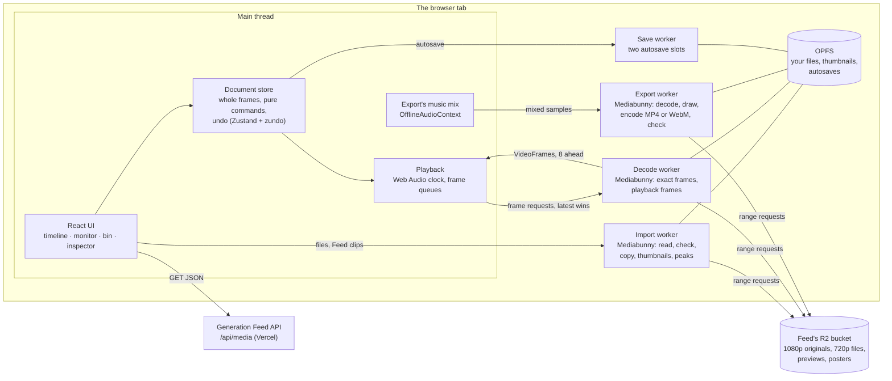

# Storyboard Timeline

A frame-accurate video editor in the browser: cut AI clips from my Generation Feed into a short
film, trim and split them to the exact frame, add music, and export an MP4, all on your own device,
with no upload and no account.

**Live: https://storyboard-timeline.vercel.app**

<table>
  <tr>
    <td></td>
    <td></td>
  </tr>
  <tr>
    <td align="center">Scrub: a thumbnail at once, then the exact frame</td>
    <td align="center">Snapping, and a whole drag undone in one step</td>
  </tr>
  <tr>
    <td></td>
    <td></td>
  </tr>
  <tr>
    <td align="center">Split at the playhead, undo, redo</td>
    <td align="center">Export, checked on this device</td>
  </tr>
</table>

**[Exact frame in 74 ms](docs/PERF.md#exact-frame)** ·
**[0 dropped frames over 45 s](docs/PERF.md#dropped-frames)** ·
**[1080p export at 2.0× real time](docs/PERF.md#export-1080p)** (from the Feed's storage at about
50 Mbit/s: the export waits on the network, [below](#the-numbers))

Independent project, not affiliated with Higgsfield. Demo clips come from my Generation Feed and
were made with Higgsfield's public API.

## The problem

A video editor's hard parts are the ones a user never sees: every edit has to land on a whole
frame, a scrub has to show a picture while the pointer is still moving, playback can't drop frames
or drift from the music, and none of it can freeze the page while megabytes of video decode. Doing
that in a browser tab, with no server, means WebCodecs, workers, the browser's private file system
and Web Audio, and keeping a dozen kinds of failure (a codec the browser can't play, a network that
drops, a full disk) from taking the work down.

## The approach

- **A document of whole frames.** Clip positions and lengths are integers at the project's frame
  rate; seconds and microseconds appear only where the app talks to a decoder. Every edit is a pure
  command, `(project, args) → project`, so undo puts the previous object back.
- **Media off the main thread.** Mediabunny on top of WebCodecs runs in workers: one imports and
  makes thumbnails, one decodes the monitor's frames and playback, one exports. The main thread only
  draws, and the media engine loads only when media is added.
- **A two-stage scrub and an audio clock.** While dragging, the monitor shows the nearest thumbnail
  at once; when the pointer rests, the exact frame, with stale requests dropped (latest wins).
  Playback follows the music's clock, with a bounded queue of frames per track.
- **Remote media read in place.** The robot story's clips are read from the Feed's storage with
  range requests, never copied: the preview reads the Feed's 720p files, export the 1080p
  originals. Your own files, thumbnails and autosaves live in the browser's private file system.
- **Measured, not assumed.** `pnpm bench` builds the app, runs every bench and writes the numbers
  with the machine and browser into [docs/PERF.md](docs/PERF.md); each optimization has a before and
  an after there.

## Architecture



## Three decisions, and what they beat

1. **Whole frames in the document, conversions at the edges.** Rejected: seconds as floats, where
   clips that "touch" can overlap by a sliver or leave a gap, and a branded `Frames` type, which
   would need a cast on every sum. A check at the door of every command catches the same mistakes
   (M1).
2. **The audio clock leads, and frames are shown on the main thread.** Rejected: presenting from
   the worker on an OffscreenCanvas with a copy of the clock, which is always a little stale (Web
   Audio isn't in workers), and would split the playhead and the picture across two threads (M4).
3. **Preview light, export full.** Measured first: an exact frame from the 1080p originals (one key
   frame per clip) took [2.5 s at p95](docs/PERF.md#the-robot-story-from-the-feed) over the
   network; from the Feed's 720p file, [84 ms](docs/PERF.md#the-robot-story-on-the-live-feed). So the
   monitor reads the 720p files and export the originals, both in ranges. Rejected: the originals
   for everything, and copying the story into the browser (243 MB) (M5).

## The numbers

Chrome is measured by `pnpm bench` on an Apple M1 Pro; the WebKit and Firefox engines are
Playwright's builds of them, run by the same benches. Each number links to its row in
[docs/PERF.md](docs/PERF.md).

| | Goal | Google Chrome 155 | WebKit engine (Playwright 27.2) | Firefox engine (Playwright 157) |
| --- | --- | --- | --- | --- |
| A picture while dragging the playhead, p95 | ≤ 50 ms | [15 ms](docs/PERF.md#scrub-picture) | [15 ms](docs/PERF.md#the-browser-matrix) | [9 ms](docs/PERF.md#the-browser-matrix) |
| The exact frame once the pointer rests, p95: the story · 1080p files | ≤ 200 ms | [74 ms · 118 ms](docs/PERF.md#exact-frame) | [166 ms · 174 ms](docs/PERF.md#the-browser-matrix) | [129 ms · **343 ms**](docs/PERF.md#the-browser-matrix) |
| Late or dropped frames, worst of 5 plays: the story · two-track 1080p files | ≤ 1 % | [0 · 0](docs/PERF.md#dropped-frames) | [0 · 0.9 %](docs/PERF.md#the-browser-matrix) | [0.9 % · 0.7 %](docs/PERF.md#the-browser-matrix) |
| Drag, trim and zoom | 60 FPS | [60 FPS](docs/PERF.md#the-browser-matrix) | [60 FPS](docs/PERF.md#the-browser-matrix) | [120 FPS](docs/PERF.md#the-browser-matrix) |
| First visit: the story's filmstrips in | | [4.0 s](docs/PERF.md#filmstrips) | [7.7 s](docs/PERF.md#the-browser-matrix) | [4.6 s](docs/PERF.md#the-browser-matrix) |
| 1080p export from the Feed | ≥ 1× real time | [2.0×](docs/PERF.md#export-1080p) (r2.dev at ~5 MB/s); [0.6×](docs/PERF.md#export-today) (at ~2 MB/s) | [0.6×](docs/PERF.md#the-browser-matrix) (at ~2 MB/s) | [**0.3×**](docs/PERF.md#the-browser-matrix): its VP9 encoder |
| The export's format | | [MP4 (H.264, AAC)](docs/PERF.md#the-browser-matrix) | [MP4 (H.264, AAC)](docs/PERF.md#the-browser-matrix) | [WebM (VP9, Opus)](docs/PERF.md#the-browser-matrix): no AAC encoder |
| First-load JS, gzip | ≤ 120 KB | [114.5 KB](docs/PERF.md#first-load-js) | the same | the same |

The 1080p export reads the clips' originals from the Feed's storage,
[about 145 MB](docs/PERF.md#what-an-export-downloads), and waits on it: from the bucket's
rate-limited `r2.dev` address it ran at [2.0× real time](docs/PERF.md#export-1080p) one day and
[0.6×](docs/PERF.md#export-today) on a slow afternoon, and at [7.5×](docs/PERF.md#export-1080p)
with the same files served from the machine itself. Firefox's engine encodes WebM, with a VP9
encoder slower than real time at 1080p, and reaches the exact frame on 1080p files more slowly than
the goal.

## Tests and accessibility

- 902 unit and component tests (Vitest, Testing Library, user-event), including property tests
  with fast-check: thousands of random edits on random projects never break a rule, and undo after
  any edit gives back the exact project.
- 130 end-to-end runs in Google Chrome and WebKit (Playwright) on every push, against the
  production build, with the Feed routed to fixtures; the same suite passes in Firefox's engine
  too (`pnpm test:e2e:firefox`). The fixtures paint each frame's index into its pixels, so the
  tests read the monitor back and know exactly which frame is on screen after a step, a scrub, a
  pause or an export.
- The whole edit works from the keyboard: clips are Tab stops, a selected clip's trim handles are
  W3C sliders with timecode values, Alt and the arrows nudge, a held key is one undo step, and one
  live region says each edit. axe finds no serious or critical issue (WCAG 2.0 to 2.2, A and AA) on
  the empty project, the story with a clip's sliders, the app bar's dialogs, the export dialog and
  the phone view, in both browsers. Reduced motion turns off every transition.

## When things go wrong

Every state in the spec has its screen and its words: the Feed unreachable (Retry, while local
editing goes on); a file the browser can't open, and why (HEVC, 10-bit, ProRes); a clip whose frames
stop decoding mid-play (paused, with "Play from the next clip"); no encoder for export (which
browser to use), an export that fails or is canceled (the project untouched); storage full (the
last good save kept); offline (editing and saving go on, the Feed's clips that need the network
dimmed); the project open in another tab (and taking it over); a file whose copy is gone; and a
phone, where the cut plays read-only.

## Prior art

Open-source browser editors that do more than this one, and how this one differs. No code from
them is used here.

- **[OpenCut](https://github.com/OpenCut-app/OpenCut)**, the open-source CapCut alternative, has far
  more features and is being rebuilt around a Rust core; this one stays small and publishes its
  numbers: scrub latency, dropped frames and export speed, with the bench that measures them.
- **[FreeCut](https://github.com/walterlow/freecut)** has WebGPU effects, keyframes and export to
  many formats; this one proves its time model instead, with tests that read each frame's index out
  of the pixels after an edit, a scrub or an export.
- **[Omniclip](https://github.com/omni-media/omniclip)** offers embeddable editor components and
  collaboration; this one is built around a pipeline from my own Feed, reading AI clips from their
  storage in ranges, and keeps its first load at [114 KB of JS](docs/PERF.md#first-load-js).

## Known limits

Music is decoded whole (an hour would take gigabytes); the thumbnails made in a session stay in
memory (about 200 MB an hour of video); a finished export is held in memory until the dialog closes
(fine for a short film, not for long projects); a clip narrower than 24 px on screen is a smaller
target than WCAG 2.2 asks; in Safari, buttons need Option+Tab, as on every site.

## Credits and licenses

- The code is MIT-licensed ([LICENSE](LICENSE)).
- [Mediabunny](https://github.com/Vanilagy/mediabunny) (MPL-2.0), unmodified, in the media
  workers; its source is at that link. [React](https://react.dev), [Zustand](https://github.com/pmndrs/zustand),
  [zundo](https://github.com/charkour/zundo) and [zod](https://zod.dev) are MIT-licensed.
- The font is [Instrument Sans](https://github.com/Instrument/instrument-sans) (SIL Open Font
  License 1.1), self-hosted with Fontsource.
- The demo music, `public/demo/music.mp3`, is a placeholder synthesized with ffmpeg by
  `scripts/make-demo-music.sh` (no samples, so no license restrictions).
- The robot story's 15 clips are AI-generated (Kling 2.5 Pro, through Higgsfield's public API) and
  served by the [Generation Feed](https://generation-feed.vercel.app); they aren't in this repo and
  aren't covered by its license.
- The design: 12 boards with every screen and state, described in
  [docs/design/README.md](docs/design/README.md).

## Run it locally

Needs Node 24 (`nvm use`) and pnpm (`corepack enable`).

```bash
pnpm install
pnpm dev
```

| Command | What it does |
| --- | --- |
| `pnpm dev` | Dev server at http://localhost:5173 |
| `pnpm lint` | ESLint |
| `pnpm typecheck` | TypeScript (`tsc -b`) |
| `pnpm test` | Unit and component tests (Vitest); `pnpm test:watch` reruns them on save |
| `pnpm build` | Production build into `dist/` |
| `pnpm preview` | Serves the production build at http://localhost:4173 |
| `pnpm test:e2e` | End-to-end tests in Google Chrome and WebKit (run `pnpm build` first) |
| `pnpm test:e2e:firefox` | The same tests in Playwright's Firefox engine (once: `pnpm exec playwright install firefox`) |
| `pnpm bench` | Builds, serves the build and runs every bench below in turn, then adds a dated summary table to `docs/PERF.md` (about 15 minutes; `pnpm bench webkit` or `firefox` for Playwright's engines, or bench names to run some) |
| `pnpm bench:editing` | Frame rate and interactions while editing, in Chrome (run `pnpm preview` first); `pnpm bench:editing files` edits imported files |
| `pnpm bench:import` | How long importing a 1080p clip takes, step by step, in Chrome (run `pnpm preview` first) |
| `pnpm bench:playback` | Scrub latency, late frames, open frames and memory over five plays of a two-track 1080p cut, in Chrome (needs ffmpeg; run `pnpm preview` first); `pnpm bench:playback story` measures the robot story from the Feed |
| `pnpm bench:export` | Export speed (× real time) for the robot story at 1080p and 720p from the Feed, with where the time goes, open frames and memory, in Chrome (run `pnpm preview` first); `pnpm bench:export local` serves the Feed's files from this machine (build with `VITE_FEED_ORIGIN` and `VITE_MEDIA_ORIGIN` set to `http://localhost:4300`) |
| `bash e2e/fixtures/make-fixtures.sh` | Remakes the test clips with ffmpeg |
| `bash scripts/make-demo-music.sh` | Remakes the robot story's placeholder music with ffmpeg |
| `node scripts/record-clips.ts` | Records the four demo clips from the build on port 4173, as MP4s and animated WebPs, into `demo-clips/` (needs ffmpeg and libwebp's `img2webp`) |

Each bench also takes `webkit` or `firefox` for Playwright's engines.

## The Feed

The editor reads the Generation Feed's clips from its API and its media storage, with range
requests, and never copies them. Two build settings say where they are; without them, the live
Feed and its bucket:

| Setting | Default |
| --- | --- |
| `VITE_FEED_ORIGIN` | `https://generation-feed.vercel.app` |
| `VITE_MEDIA_ORIGIN` | `https://pub-b6efd72fde71478fa4b96c65e2f0928d.r2.dev` |

The Feed's API sends `Access-Control-Allow-Origin: *`, and its bucket's CORS policy lets this
app's addresses read its files in ranges.

`/?demo=story` opens the robot story: at once into an empty project, and when there's a cut
already, the app keeps it and offers New project first. The Feed's "Open in Timeline" links here.

## Deploys

GitHub Actions deploys to Vercel once every check passes: pushes to `main` go to production,
and each pull request gets a preview link. Vercel's own Git deploys aren't used. The deploy job needs a `VERCEL_TOKEN` repository secret holding a token
from the Vercel account that owns the project, with access to its team.
